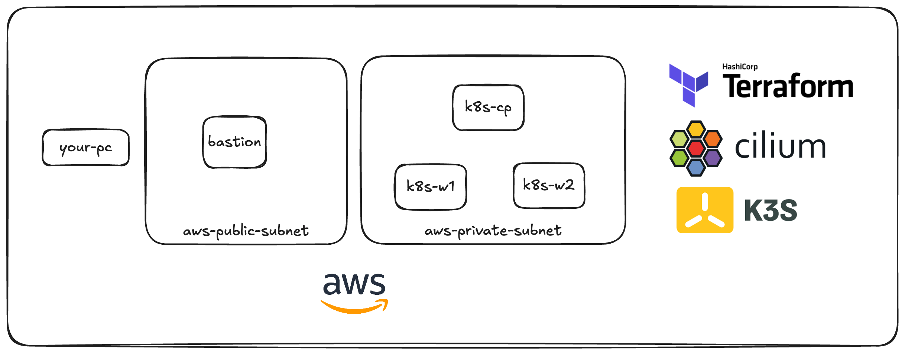
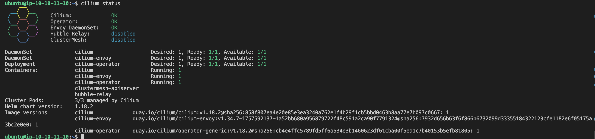

# cilium-demo

Lab environment:



1. Apply Terraform configuration by entering the terraform directory and running `terraform apply`.

2. For convenience, you can add aliases to quickly connect from one host to another. These can be obtained from the terraform outputs:

```sh
alias bastion="$(terraform output -raw bastion_connection_string)"
alias controlplane="$(terraform output -raw controlplane_connection_string)"
alias node1="$(terraform output -raw node01_connection_string)"
alias node2="$(terraform output -raw node02_connection_string)"
```

Using these aliases (`bastion`, `controlplane`, `node1`, `node2`), you can easily connect to the proper instance.

3. Install k3s on the control plane node.

**References:**
- [k3s | Quick start](https://docs.k3s.io/quick-start)
- [k3s | Configuration options](https://docs.k3s.io/installation/configuration)
- [k3s | Server configuration options](https://docs.k3s.io/cli/server)

Connect to the control plane using the alias:

```sh
controlplane
```

Install k3s with the following options disabled:

- `--flannel-backend=none` - Disables the default k3s Flannel CNI
- `--disable-network-policy` - Disables the default policy engine
- `--disable-kube-proxy` - Disables the default kube-proxy (we'll use Cilium's eBPF-based kube-proxy replacement)
- `--disable servicelb` - Disables K3s's default load balancer (Klipper)
- `--disable traefik` - Disables the Traefik ingress controller (enabled by default in k3s)

```sh
curl -sfL https://get.k3s.io | INSTALL_K3S_EXEC='--flannel-backend=none --disable-network-policy --disable-kube-proxy --disable servicelb --disable traefik --write-kubeconfig-mode "0644"' sh -
```

Export the kubeconfig to use kubectl:

```sh
export KUBECONFIG="/etc/rancher/k3s/k3s.yaml"
# or
mkdir -p ~/.kube
cp /etc/rancher/k3s/k3s.yaml ~/.kube/config
```

Check the status of the nodes:

```sh
$ kubectl get node
NAME             STATUS     ROLES                  AGE   VERSION
ip-10-10-11-10   NotReady   control-plane,master   67s   v1.33.5+k3s1
```

4. Configure Cilium.

You can configure Cilium in different ways:

   1. **Proxy Kubernetes API to your local machine:**

      Use SSH port forwarding:

      ```sh
      ssh -L 6443:10.10.11.10:6443 ubuntu@<bastion-ip>
      ```

   2. **Install Helm and Cilium on the bastion/control plane node:**

      a. **Install Helm** (Source: https://helm.sh/docs/intro/install/)

        ```sh
        curl -fsSL -o get_helm.sh https://raw.githubusercontent.com/helm/helm/main/scripts/get-helm-4
        chmod 700 get_helm.sh
        ./get_helm.sh

        # Verify installation:
        helm version
        ```

      b. **Install Cilium CLI** (Source: https://docs.cilium.io/en/stable/gettingstarted/k8s-install-default/)

      ```sh
      CILIUM_CLI_VERSION=$(curl -s https://raw.githubusercontent.com/cilium/cilium-cli/main/stable.txt)
      CLI_ARCH=amd64
      if [ "$(uname -m)" = "aarch64" ]; then CLI_ARCH=arm64; fi
      curl -L --fail --remote-name-all https://github.com/cilium/cilium-cli/releases/download/${CILIUM_CLI_VERSION}/cilium-linux-${CLI_ARCH}.tar.gz{,.sha256sum}
      sha256sum --check cilium-linux-${CLI_ARCH}.tar.gz.sha256sum
      sudo tar xzvfC cilium-linux-${CLI_ARCH}.tar.gz /usr/local/bin
      rm cilium-linux-${CLI_ARCH}.tar.gz{,.sha256sum}

      # Verify installation:
      cilium version
      ```

5. Install Cilium.

   **Option A: Install using Cilium CLI:**

      ```sh
      export KUBECONFIG="/etc/rancher/k3s/k3s.yaml"
      cilium install --set cluster.name=cilium-demo-01 \
        --set kubeProxyReplacement=true \
        --set k8sServiceHost=10.10.11.10 \
        --set k8sServicePort=6443

      # Check Cilium installation status:
      cilium status --wait
      ```

   **Option B: Install using Helm:**

   ```sh
   export KUBECONFIG="/etc/rancher/k3s/k3s.yaml"
   helm upgrade --install -n kube-system cilium cilium/cilium \
     --set cluster.name=cilium-demo-01 \
     --set kubeProxyReplacement=true \
     --set k8sServiceHost=10.10.11.10 \
     --set k8sServicePort=6443
   ```

   If you encounter any errors during installation, review the output and fix the issues before proceeding. You should see all options are healthy as shown in the image below:

    

6. Install k3s on worker nodes and join the cluster.

On the control plane, retrieve the node token:

```sh
cat /var/lib/rancher/k3s/server/node-token
```

This token is used for node registration.

Join the first worker node:

```sh
node1

export K3S_CP_TOKEN="..." # Token from the previous command

# Install k3s agent
curl -sfL https://get.k3s.io | INSTALL_K3S_EXEC="agent --server https://10.10.11.10:6443 --token $K3S_CP_TOKEN" sh -s -
```

Repeat the same process for the second node.

After that, exit from the worker node, return to the control plane, and verify that the nodes were added to the cluster:

```sh
$ kubectl get nodes
NAME             STATUS   ROLES                  AGE   VERSION
ip-10-10-11-10   Ready    control-plane,master   61m   v1.33.5+k3s1
ip-10-10-11-20   Ready    <none>                 96s   v1.33.5+k3s1
ip-10-10-11-21   Ready    <none>                 73s   v1.33.5+k3s1
```

**(Optional)** To verify the Cilium installation, run the connectivity test provided by the Cilium team. This operation may take some time:

```sh
cilium connectivity test
```

At this stage, you should have k3s and Cilium up and running.

## Enable L2 Announcement and Ingress Controller

### About L2 Announcement

L2 (Layer 2) announcement in Cilium allows Kubernetes service and pod IPs to be advertised directly on the local network using ARP, making them reachable from outside the cluster without extra load balancers or NAT. This is especially important in on-premises or bare-metal environments, where cloud-native load balancers are not available. By enabling L2 announcement, Cilium ensures that external devices on the same network segment can access Kubernetes services as if they were native hosts. This simplifies network integration and service exposure in non-cloud setups. In summary, L2 announcement bridges Kubernetes networking with traditional LANs, making services easily accessible in on-premises environments.

In addition, we'll enable the Envoy ingress controller that Cilium includes as an installation option.

> **Note:** Keep in mind that the networking concept in AWS is different from typical on-premises environments. We are simulating this behavior for educational purposes only—this is not a production-ready solution.

### Upgrade Cilium Installation

Prepare the values file (`cilium-values.yaml`):

```yaml
cluster:
  name: cilium-demo-01

kubeProxyReplacement: true
k8sServiceHost: 10.10.11.10 # This is controlplane IP, it's needed when we have kube-proxy replacement
k8sServicePort: 6443

# Enable L2 announcements for LoadBalancer services
l2announcements:
  enabled: true
  leaseDuration: 3s
  leaseRenewDeadline: 1s
  leaseRetryPeriod: 200ms

# Enable L2 neighbor discovery - This is needed to be able to work Load Balancer concept
l2NeighDiscovery:
  enabled: true

# Enable Cilium Ingress Controller
ingressController:
  enabled: true
  loadbalancerMode: shared
  default: true

externalIPs:
  enabled: true
```

Apply the upgrade:

```sh
# Ensure KUBECONFIG is set
export KUBECONFIG="/etc/rancher/k3s/k3s.yaml"

cilium upgrade --reuse-values -f cilium-values.yaml

kubectl rollout restart -n kube-system deploy/cilium-operator
kubectl rollout restart -n kube-system ds/cilium
```

### Configure L2 Announcement Policy

Set the `CiliumL2AnnouncementPolicy`:

```sh
cat << EOF | kubectl apply -f -
apiVersion: "cilium.io/v2alpha1"
kind: CiliumL2AnnouncementPolicy
metadata:
  name: l2-policy
spec:
  serviceSelector: {}
  nodeSelector:
    matchExpressions:
      - key: node-role.kubernetes.io/control-plane
        operator: DoesNotExist
  interfaces:
  - ^eth[0-9]+ # This should be checked and modified if you have another interface name pattern
  externalIPs: true
  loadBalancerIPs: true
EOF
```

**Notes:**
- `nodeSelector` is defined as an example to show configurability. You can customize which nodes participate in L2 announcements.
- `serviceSelector` can also be used to select specific services and apply different announcement policies to them.

### Configure IP Pool

Set the IP pool to be used for L2 announcement:

```sh
cat << EOF | kubectl apply -f -
apiVersion: "cilium.io/v2alpha1"
kind: CiliumLoadBalancerIPPool
metadata:
  name: "lb-pool"
spec:
  blocks:
  - start: "10.10.11.5"
    stop: "10.10.11.7"
EOF
```

If needed, restart the Cilium pods:

```sh
export KUBECONFIG="/etc/rancher/k3s/k3s.yaml"

kubectl rollout restart -n kube-system deploy/cilium-operator
kubectl rollout restart -n kube-system ds/cilium
```

### Verify Installation

Check the Kubernetes services. You should see that the Cilium ingress is configured and an IP has been assigned:

```sh
$ kubectl get svc -A
NAMESPACE     NAME             TYPE           CLUSTER-IP      EXTERNAL-IP   PORT(S)                      AGE
default       kubernetes       ClusterIP      10.43.0.1       <none>        443/TCP                      85m
kube-system   cilium-envoy     ClusterIP      None            <none>        9964/TCP                     74m
kube-system   cilium-ingress   LoadBalancer   10.43.190.211   10.10.11.5    80:31400/TCP,443:30184/TCP   67m
kube-system   hubble-peer      ClusterIP      10.43.97.167    <none>        443/TCP                      74m
kube-system   kube-dns         ClusterIP      10.43.0.10      <none>        53/UDP,53/TCP,9153/TCP       85m
kube-system   metrics-server   ClusterIP      10.43.39.102    <none>        443/TCP                      85m
```

### Deploy Demo Application

Deploy a simple web application with a Deployment, Service, and Ingress resource:

```yaml
apiVersion: apps/v1
kind: Deployment
metadata:
  name: cilium-demo-01
spec:
  replicas: 1
  selector:
    matchLabels:
      app: cilium-demo-01
  template:
    metadata:
      labels:
        app: cilium-demo-01
    spec:
      containers:
      - name: podinfo
        image: ghcr.io/stefanprodan/podinfo:latest
        ports:
        - containerPort: 9898
        env:
        - name: POD_NAME
          valueFrom:
            fieldRef:
              fieldPath: metadata.name
        - name: POD_NAMESPACE
          valueFrom:
            fieldRef:
              fieldPath: metadata.namespace
        - name: POD_NODE
          valueFrom:
            fieldRef:
              fieldPath: spec.nodeName

---
apiVersion: v1
kind: Service
metadata:
  name: cilium-demo-01
spec:
  selector:
    app: cilium-demo-01
  ports:
  - port: 80
    targetPort: 9898
  type: ClusterIP

---
apiVersion: networking.k8s.io/v1
kind: Ingress
metadata:
  name: cilium-demo-01
spec:
  rules:
  - http:
      paths:
      - path: /
        pathType: Prefix
        backend:
          service:
            name: cilium-demo-01
            port:
              number: 80
```

Verify that the Ingress was properly configured:

```sh
$ kubectl get ing
NAME             CLASS    HOSTS   ADDRESS      PORTS   AGE
cilium-demo-01   <none>   *       10.10.11.5   80      74s
```

Test the application by curling the ingress IP from one of the nodes:

```sh
$ curl 10.10.11.5
{
  "hostname": "cilium-demo-01-8664c76fb8-b4c8g",
  "version": "6.9.3",
  "revision": "d9fec9778d564fe00d17919121b5822488e0c2d0",
  "color": "#34577c",
  "logo": "https://raw.githubusercontent.com/stefanprodan/podinfo/gh-pages/cuddle_clap.gif",
  "message": "greetings from podinfo v6.9.3",
  "goos": "linux",
  "goarch": "amd64",
  "runtime": "go1.25.4",
  "num_goroutine": "6",
  "num_cpu": "2"
}
```

### Important Note About AWS Networking

> **Note:** Keep in mind that since we are running this demo in AWS, ARP (L2) announcement will not work the same way as it does in on-premises environments. This is a demo setup to showcase the feature, but it is not production-ready.

**Why L2 Announcement Works Differently on AWS:**

L2 announcement relies on sending ARP broadcasts to advertise service IPs directly on the local network. In on-premises or bare-metal environments, this allows external devices to discover and reach Kubernetes services easily. However, AWS VPC networking does not support custom ARP broadcasts or direct Layer 2 communication between EC2 instances. AWS manages ARP responses internally, so Cilium's L2 announcement cannot make service IPs reachable from outside the cluster as it would on a traditional LAN. This limitation is why L2 announcement behaves differently on AWS compared to on-premises setups.

### Verify ARP Table

Check the ARP table on a node. Notice that the virtual IP is not shown:

```sh
$ ip neigh
10.10.11.1 dev ens5 lladdr 06:8a:ee:5b:af:f1 managed extern_learn REACHABLE 
10.0.2.196 dev lxc_health lladdr d2:3a:15:b6:13:ad STALE 
10.10.11.21 dev ens5 managed extern_learn INCOMPLETE 
10.10.11.10 dev ens5 lladdr 06:b2:5a:ed:8d:f9 managed extern_learn REACHABLE 
10.0.2.25 dev lxce87a3230ffca lladdr b6:2f:f6:a6:41:d9 STALE 
10.10.11.20 dev ens5 lladdr 06:41:bf:fd:e3:61 managed extern_learn REACHABLE
```

**Explanation:**

This is expected behavior in AWS. The ARP table on your node does not show the virtual IP assigned by Cilium's L2 announcement because AWS VPC networking does not support custom ARP broadcasts or direct Layer 2 communication. Instead, AWS manages ARP responses internally and handles routing for LoadBalancer services at the VPC level. That's why your load balancer works, but you don't see the virtual IP in the ARP table—traffic is routed by AWS, not by local ARP resolution as it would be in an on-premises environment.

---

**Congratulations!** You've successfully set up a k3s cluster with Cilium CNI, L2 announcements, and Ingress controller.
